<!-- Profile layout follows the animated SVG-card composition: hero, heatmap, activity, three worlds, and featured repositories. -->

 
 
 
 
 

<a href="https://github.com/Akashsenthilkumar08">GitHub</a> &nbsp;/&nbsp; <a href="https://github.com/Akashsenthilkumar08?tab=repositories">Projects</a> &nbsp;/&nbsp; <a href="mailto:kit25csebakash@gmail.com">Email</a>

