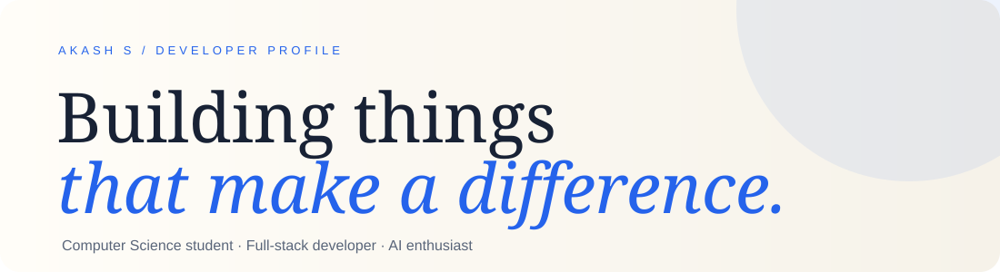
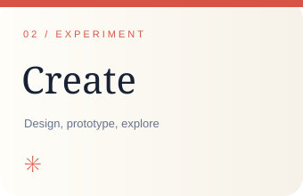

<!--
  AKASH S — GitHub profile
  Cards are generated by scripts/render_readme_cards.py.
-->

  

  
  

  

## Three worlds. One curious builder.

  
  
  

## What I’m about

I’m **Akash S**, a Computer Science student and developer who enjoys turning ambitious ideas into useful digital products. I work across full-stack development, AI-powered applications, automation and interactive web experiences.

- **BUILD** — Full-stack applications, APIs and practical tools.
- **EXPLORE** — AI, automation, data-driven products and emerging interfaces.
- **LEARN** — New technologies through experiments, projects and hackathons.

## Selected projects

| Project | What it explores |
|---|---|
| [RescueVoice](https://github.com/Akashsenthilkumar08/rescuevoice) | Real-time, interruption-aware voice agent and conversational AI |
| [SYNAPSE 2026](https://github.com/Akashsenthilkumar08/prompt_wars) | 3D interactive event-management and matchmaking platform |
| [Eduway](https://github.com/Akashsenthilkumar08/eduway) | Education management platform built with Next.js |
| [Maze Runner](https://github.com/Akashsenthilkumar08) | Interactive game project built for the Reddit Devvit ecosystem |

## Tools I enjoy

  

## Currently exploring

AI engineering · Full-stack product development · Interactive 3D web · UI/UX · Automation

---

  Designed in ink, paper and electric blue · SVG cards refresh automatically every day

